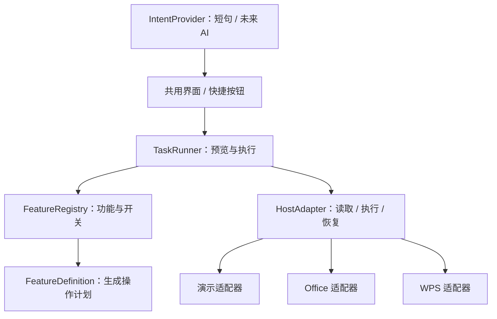

# 架构

## 依赖方向

- `core` 只定义普通 TypeScript 数据和执行规则，不导入 React、Office.js 或 WPS。
- 功能模块只从 `core` 导入类型或辅助函数，不直接访问 `window`、原生接口或网络。
- 宿主代理对象只能存在于 `adapters` 内，读取结果必须转成可克隆的普通数据。
- UI 通过运行时依赖装配获得服务，不根据宿主品牌实现功能分支。演示文档是独立展示组件。
- `IntentProvider` 返回功能 ID 或候选项，最终仍经同一个注册表和执行器验证。接入模型不会获得任意代码执行能力。

## 新增功能时的修改范围

| 改动                       | 主要修改位置                                             |
| -------------------------- | -------------------------------------------------------- |
| 新增现有能力可完成的任务   | `features/<name>/feature.ts` + 注册入口                  |
| 临时关闭功能               | `app/config.ts`                                          |
| 修改字号、文案、布局       | `ui/`                                                    |
| 新增一种模型或语音转文字   | `services/`，在 `app/runtime.ts` 装配                    |
| 新增宿主支持               | 实现 `HostAdapter`，在 `adapters/index.ts` 装配          |
| 新增写入原语，例如段落居中 | 增加 `ActionPlan` 分支、能力声明、执行器验证和各宿主实现 |

不引入独立服务、数据库或复杂工作区包管理；当前规模下单工程更易运行。边界已经建立，后续可以再将 `core` 提取为独立包。

## 执行约束

1. 读取功能定义与宿主能力，不支持的入口不可执行。
2. 从宿主读取有大小限制的选区快照，生成计划。
3. 执行器再次校验计划类型、参数和宿主能力。每次只保留一个待确认任务。
4. 用户确认后根据内部任务 ID 执行，界面不能直接传入或修改执行计划。
5. 执行前核对文档、选区、内容和版本；适配器在写入边界还需复核。
6. 返回结果和可选恢复凭据。恢复由原适配器处理，并检查后续编辑冲突。

执行器同时只允许一个异步操作。取消、已执行或被新预览替代的任务无法再次执行。写入失败后不保留旧的恢复入口。日志只包含功能 ID、标题、时间和状态，最多 20 条。

## 当前原生写入边界

Office 清单已请求 `ReadWriteDocument`。WordApi 1.3 可用时开放 `text.resize`、`text.bold`、`paragraph.center`、`paragraph.spacing`、`paragraph.indent` 与 `history.undo`，跟踪原生 Range 并比较选区位置。写入仅设置此次要求的原生格式属性；恢复只还原该属性，每个段落使用各自原值。仅有 WordApi 1.1 的客户端维持只读：快照使用稳定的报告标识，不调用位置比较或跟踪接口，不能用于写入定位。Excel 当前只读。新增格式能力目前通过宿主替身测试，真实任务窗格验收仍待完成。

文字快照增加粗细、所在完整段落的正文、对齐、行距、首行及左右缩进、列表状态；这些值参与预览过期和恢复冲突检查。最多20个段落、完整段落合计20,000字符。预览明确部分选字也会作用于所在整段，并逐段显示原值与目标值。行距只接受能从规范 Word OOXML 中确认显式 `auto` 规则且与原生读取值一致的倍数行距；只读取 OOXML，不用 XML 重写段落。继承规则、固定行距、表格和修订包装不作猜测。编号段落暂不能修改首行缩进。

数值边界由解析器、计划验证和适配器重复核对：字号8–72磅且精度0.5磅；行距1–3倍且精度0.05倍；首行缩进0–144磅且精度0.05磅。厘米输入会换算并取至0.05磅，确认前显示实际目标值。参数按钮的 `inputPrompt` 只填写操作前缀并聚焦输入框，不生成默认参数。未知余文、否定和多步请求会要求澄清。

WPS 文字开放字号、加粗／取消加粗、普通正文段落居中、倍数行距、首行缩进和单步恢复。适配器使用 `Selection.Range.Duplicate` 保留目标，写入前核对快照、当前文档身份与 Range 归属，并拒绝只读／受保护文档。粗细仅识别 `-1`／`true` 和 `0`／`false`，混合或未知值不允许加粗操作；缺失粗细接口不会阻断原有字号操作。每次只写目标格式的属性，恢复逐段还原原值。后续编辑冲突会拒绝覆盖。写入或结果回读失败会清除旧恢复凭据，并提示检查文档及使用 WPS 原生撤销。WPS 表格当前只读。

WPS 行距从运行时 `WdLineSpacing` 解析规则，原有单倍／1.5倍／双倍规范化为12／18／24磅，多倍保留原始规则与磅值。WPS 将1／1.5／2倍规范化为内置规则，写入和回读按此检查；其他倍数先写多倍规则再写 `multiple * 12`。固定、未知、异常规则／数值组合在预览前拒绝。原生浮点值只在距0.05磅网格小于0.0005磅时归一化，恢复仍保留原始值。

WPS 首行缩进同时读取 `FirstLineIndent` 和 `CharacterUnitFirstLineIndent`。写磅值前清除字符缩进，否则WPS会忽略磅值；恢复先清除字符值、还原磅值，再还原非零字符值，并回读核对。字符接口缺失只禁用缩进。用户参数仍为磅／厘米，不接受字符数。字号操作允许字符缩进有效磅值随字号变化，恢复仍核对原始段落状态。行网格设置保持原样，视觉行高还会受文档网格影响。

WPS 段落读取在 `paragraphs.ts` 内隔离：部分选字扩展为相交的完整段落，独占结束位置恰为下一段起点时排除该段；最多20段／20,000完整段落字符。只支持能确认的普通主正文，表格、列表、其他 Story 或缺失属性会拒绝段落操作，不影响小范围字号与加粗。枚举兼容运行时的平铺和分组结构，不硬编码 Office 数值。预览及恢复比较完整正文、位置、对齐、间距、行距规则与缩进，逐段恢复本次修改属性的各自原值；移动选区不会改变保留的恢复目标。插入光标不视为已选文字。

字号修改只支持字号一致的选区，加粗修改只支持粗细一致的选区；段落对齐等属性可逐段保留不同原值。仅支持会话内最后一次格式修改的恢复，不提供任意操作历史。混合格式、原生撤销交互、未保存文档重开、多窗口和保存后的恢复仍需进一步实机验证；路径、名称及窗口信息不能被当作永久文档身份。

Microsoft Word 和 WPS 文字已有真实任务窗格 18 → 22 → 18 磅验证记录，Excel 和 WPS 表格已有四格合计 450.5 的历史记录。本轮 WPS 12.1.0.29690 文字再次验证字号，并通过加粗／取消加粗、完整段落居中、倍数行距、首行缩进及恢复；原生诊断覆盖混合原值、字符缩进恢复、部分选字、独占结束边界、移动选区恢复、过期预览与恢复冲突，正常侧栏操作也通过。该版本表格四格合计 450.5 的原生诊断及正常侧栏预览／取消／只读查询通过；文字错误、预览与表格默认／大字号反馈的自动滚动已实机回归。适配器替身测试检查边界行为，不能替代真实客户端与复杂文件验收。版本及范围见 [验证记录](./verification.md)。
