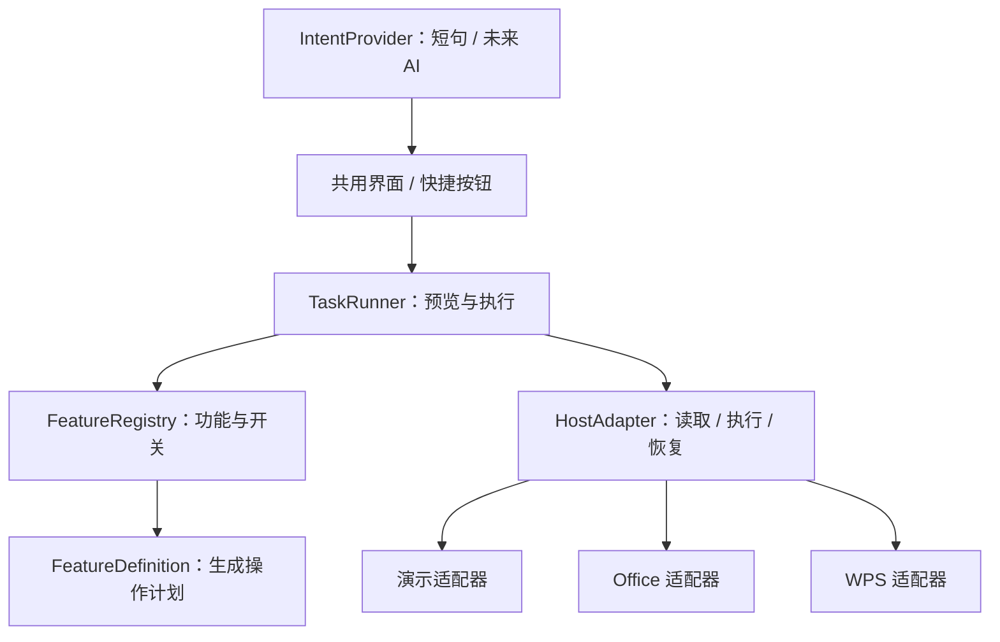

# 架构

## 依赖方向

- `core` 只定义普通 TypeScript 数据和执行规则，不导入 React、Office.js 或 WPS。
- 功能模块只从 `core` 导入类型或辅助函数，不直接访问 `window`、原生接口或网络。
- 宿主代理对象只能存在于 `adapters` 内，读取结果必须转成可克隆的普通数据。
- UI 通过运行时依赖装配获得服务，不根据宿主品牌实现功能分支。演示文档是独立展示组件。
- `IntentProvider` 返回功能 ID 或候选项，最终仍经同一个注册表和执行器验证。接入模型不会获得任意代码执行能力。

## 新增功能时的修改范围

| 改动                       | 主要修改位置                                             |
| -------------------------- | -------------------------------------------------------- |
| 新增现有能力可完成的任务   | `features/<name>/feature.ts` + 注册入口                  |
| 临时关闭功能               | `app/config.ts`                                          |
| 修改字号、文案、布局       | `ui/`                                                    |
| 新增一种模型或语音转文字   | `services/`，在 `app/runtime.ts` 装配                    |
| 新增宿主支持               | 实现 `HostAdapter`，在 `adapters/index.ts` 装配          |
| 新增写入原语，例如段落居中 | 增加 `ActionPlan` 分支、能力声明、执行器验证和各宿主实现 |

不引入独立服务、数据库或复杂工作区包管理；当前规模下单工程更易运行。边界已经建立，后续可以再将 `core` 提取为独立包。

## 执行约束

1. 读取功能定义与宿主能力，不支持的入口不可执行。
2. 从宿主读取有大小限制的选区快照，生成计划。
3. 执行器再次校验计划类型、参数和宿主能力。每次只保留一个待确认任务。
4. 用户确认后根据内部任务 ID 执行，界面不能直接传入或修改执行计划。
5. 执行前核对文档、选区、内容和版本；适配器在写入边界还需复核。
6. 返回结果和可选恢复凭据。恢复由原适配器处理，并检查后续编辑冲突。

执行器同时只允许一个异步操作。取消、已执行或被新预览替代的任务无法再次执行。写入失败后不保留旧的恢复入口。日志只包含功能 ID、标题、时间和状态，最多 20 条。

## 当前原生写入边界

Office 清单已请求 `ReadWriteDocument`。WordApi 1.3 可用时开放 `text.resize` 与 `history.undo`，跟踪原生 Range 并比较选区位置；恢复使用独立范围，检查文字和字号是否又被修改。仅有 WordApi 1.1 的客户端维持只读：快照使用稳定的报告标识，不调用位置比较或跟踪接口，不能用于写入定位。Excel 当前只读。

WPS 文字适配器使用 `Selection.Range.Duplicate` 保留目标，写入前核对快照、当前文档身份与 Range 归属，并拒绝只读／受保护文档。恢复前再次核对文档、文字和字号；后续编辑冲突会拒绝覆盖。WPS 表格当前只读。

当前只支持字号一致的文字选区和会话内最后一次字号修改的恢复，不提供任意操作历史。混合格式、原生撤销交互、未保存文档重开、多窗口和保存后的恢复仍需进一步实机验证；路径、名称及窗口信息不能被当作永久文档身份。

Microsoft Word 和 WPS 文字已在真实任务窗格验证 18 → 22 → 18 磅，Excel 和 WPS 表格已验证四格合计 450.5。适配器替身测试检查边界行为，不能替代真实客户端与复杂文件验收。版本及范围见 [验证记录](./verification.md)。
